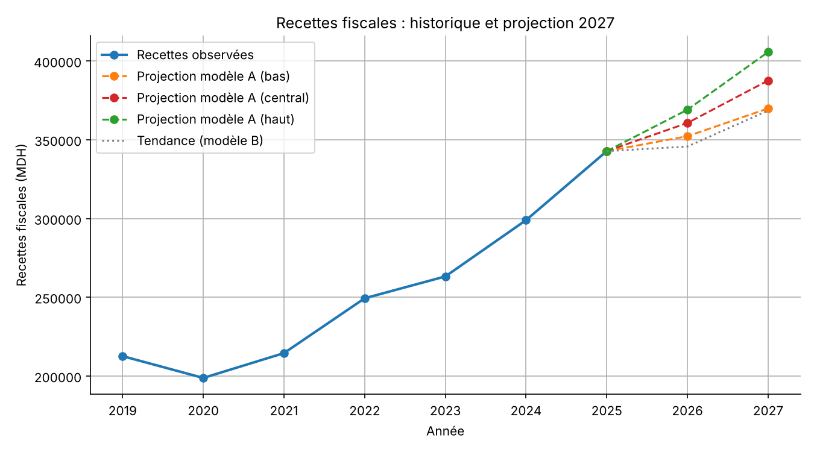

# Analyse et projection des recettes fiscales du Maroc (contexte PLF 2027)

Projet d'initiation en Python : évolution des recettes fiscales marocaines (2019-2025), lien avec le PIB nominal, et projection pour 2027 par régression linéaire.

## Contenu
- `analyse_recettes_fiscales.ipynb` : notebook complet (nettoyage, graphiques, modèle, projection)
- `donnees_recettes_fiscales.csv` : données utilisées (7 années)
- `donnees_recettes_fiscales.xlsx` : mêmes données avec sources, définitions et formules
- `figures/` : graphiques générés
- `resultats_projection.csv`, `evaluation_modeles.csv` : tableaux de résultats

## Données (MDH = millions de dirhams)
| Colonne | Description | Source |
|---|---|---|
| annee | Année | - |
| recettes_fiscales_mdh | Recettes fiscales | 2019-2023 : Ministère de l'Économie et des Finances (série reprise par Le360). 2024 : ≈ 299 MMDH annoncé par le ministre du Budget (arrondi). 2025 : calculé = 2024 + hausse de 43,8 MMDH indiquée dans le rapport d'exécution budgétaire du PLF 2027 (approximatif) |
| pib_mdh | PIB nominal (prix courants) | HCP : comptes nationaux 2021 (2019, 2020), comptes régionaux (2021, 2022), comptes nationaux provisoires 2025 (2023 à 2025) |

Hypothèse de croissance du PIB nominal : 6,8 % en 2026 et 6 % en 2027, d'après le rapport d'exécution budgétaire et de cadrage macroéconomique du PLF 2027 (Ministère de l'Économie et des Finances). Les scénarios bas et haut ajoutent -2 et +2 points.

## Méthode
1. Nettoyage avec Pandas
2. Statistiques descriptives : croissance annuelle, pression fiscale, taux de croissance annuel moyen
3. Graphiques avec Matplotlib
4. Régression linéaire (Scikit-learn) : recettes ~ PIB et recettes ~ année, test sur les 2 dernières années
5. Projection pour 2027 selon trois scénarios de PIB

## Utilisation
```bash
pip install -r requirements.txt
jupyter notebook analyse_recettes_fiscales.ipynb
```

## Résultats


- 7 années analysées (2019-2025) ; croissance annuelle moyenne des recettes : 8,3 %
- Corrélation recettes / PIB : 0,98
- Modèle A (recettes ~ PIB) : R² d'entraînement 0,89 ; erreur moyenne de 4,8 % sur les 2 années de test, contre 12,2 % pour la simple tendance (modèle B)
- Recettes fiscales projetées en 2027 (scénario central) : environ 387,7 milliards de dirhams (fourchette 369,9 à 405,7 selon le scénario de PIB)

## Limites
- Seulement 7 observations annuelles : la projection est fragile.
- Recettes et PIB nominal évoluent ensemble dans le temps : la corrélation élevée ne prouve pas une causalité.
- Les recettes 2024 et 2025 sont approximatives.
- Le modèle n'intègre ni les réformes fiscales ni les chocs ; la pression fiscale implicite de 2027 (environ 19,9 % du PIB) est supérieure à la moyenne observée (18 %).
- Il s'agit d'un exercice d'initiation, qui ne remplace pas les prévisions officielles.
